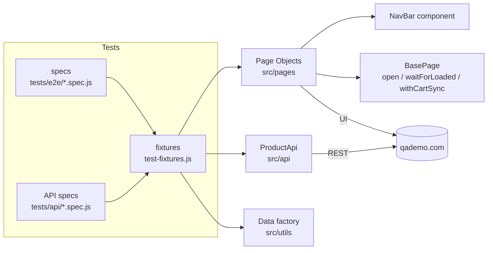
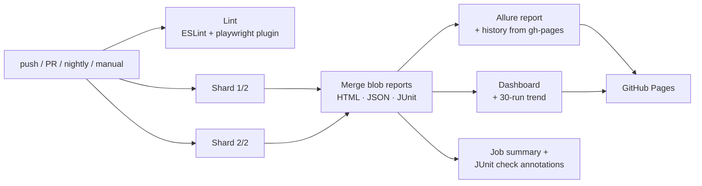

# QA Demo – Playwright E2E Automation Framework

[](https://github.com/Ammarah95/qademo-playwright-e2e/actions/workflows/e2e.yml)
[](https://ammarah95.github.io/qademo-playwright-e2e/)


End-to-end UI + API test automation for **[qademo.com](https://qademo.com)**, a live e-commerce store built for automation practice. It's written in **Playwright + JavaScript** with the **Page Object Model**. CI/CD runs on **GitHub Actions** and publishes a **test dashboard** to GitHub Pages.

> **📊 Live dashboard:** https://ammarah95.github.io/qademo-playwright-e2e/ (pass-rate trend, per-browser and per-spec breakdown, links to the Playwright and Allure reports)

---

## Highlights

| | |
|---|---|
| **Coverage** | 52 scenarios: navigation, catalog, product detail, cart, sign-up, sign-in, checkout → order history, responsive/mobile, REST API |
| **Pattern** | Page Object Model + reusable components (`NavBar`) + custom Playwright **fixtures** |
| **Browsers** | Chromium (full suite) · Firefox (smoke) · Pixel 7 emulation (mobile) · API project (no browser) |
| **Data** | Live catalog is read from `/api/products`, so tests never hard-code products whose stock changes. Users are generated per worker |
| **Reporting** | Playwright HTML · Allure (with history and trends) · JUnit · custom dashboard |
| **CI/CD** | Lint + 2 parallel test shards → merged reports → GitHub Pages. Runs on push, PR, nightly at 02:17 IST, and on demand (`all` / `smoke` / `regression`) |
| **Defects found** | 2 real bugs, documented and tracked as `@known-defect` tests (see below) |

---

## Architecture



```
.
├── .github/workflows/e2e.yml      # CI/CD: lint → sharded tests → reports → GitHub Pages
├── playwright.config.js           # projects, reporters, retries, traces
├── scripts/generate-dashboard.js  # builds the static dashboard + rolling history
├── src
│   ├── api/ProductApi.js          # live catalog lookup (in-stock / out-of-stock products)
│   ├── data/messages.js           # expected UI copy in one place
│   ├── fixtures/test-fixtures.js  # page-object fixtures, workerUser, authPage, product data
│   ├── pages/                     # Page Object Model
│   │   ├── BasePage.js
│   │   ├── components/NavBar.js
│   │   ├── HomePage.js  CatalogPage.js  ProductPage.js  CartPage.js
│   │   ├── LoginPage.js SignupPage.js   CheckoutPage.js
│   │   └── OrderConfirmationPage.js     OrdersPage.js
│   └── utils/                     # dataFactory (users, checkout data), price helpers
└── tests
    ├── api/products.api.spec.js
    └── e2e/  navigation · catalog · product · cart · auth · checkout · mobile
```

### Example: a test reads like the user journey

```js
test('E2E: place an order and see it in order history', async () => {
  await checkout.completeCheckout(buildCheckoutData());

  await expect(confirmation.heading).toHaveText('Order Confirmed!');
  const orderId = await confirmation.orderId();

  await confirmation.navbar.goToOrders();
  await expect(orders.order(orderId).number).toHaveText(`Order #${orderId}`);
});
```

---

## Getting started

```bash
git clone https://github.com/Ammarah95/qademo-playwright-e2e.git && cd qademo-playwright-e2e
npm install
npx playwright install --with-deps

npm test                 # everything (api + chromium + firefox smoke + mobile)
npm run test:smoke       # @smoke only
npm run test:chromium    # full suite, Chromium only
npm run test:headed      # watch it run
npm run report           # open the Playwright HTML report
npm run allure:generate && npm run allure:open
npm run dashboard        # build site/index.html from reports/results.json
```

Set `BASE_URL` in `.env` to point at another environment (see `.env.example`).

### Tags

| Tag | Meaning |
|---|---|
| `@smoke` | critical path, runs on every browser |
| `@regression` | full functional coverage |
| `@e2e` | complete purchase journeys |
| `@api` | REST checks, no browser |
| `@mobile` | responsive layout (Pixel 7) |
| `@known-defect` | documents a real bug with `test.fail()` |

---

## CI/CD pipeline



* **Retries:** 2 on CI. Traces, screenshots and video are kept on failure.
* **History:** the previous `history.json` and the Allure `history/` folder are restored from the `gh-pages` branch each run, so the trends survive between runs.
* **One-time setup:** in *Settings → Pages*, set the source to **Deploy from a branch → `gh-pages` / root**.

---

## Defects found

Found during exploratory testing and kept in the suite as `@known-defect` tests. Each uses `test.fail()`, so the pipeline stays green while the bug exists and **turns red the day it's fixed**. That's the signal to promote it to a normal regression test.

| ID | Area | Steps | Expected | Actual |
|---|---|---|---|---|
| **BUG-01** | Checkout | Valid card `4242…4242`, expiry **`12/20`** (Dec 2020), CVV `123`, place order | Order is rejected with an "expired card" message | **Order is placed** (e.g. #4015) |
| **BUG-02** | Checkout | Same, expiry **`13/20`** (month 13) | Field-level error under *Expiry Date* | Order is blocked, but only a generic **"Unknown error"** is shown |

Also observed (not a functional bug, but worth reporting): *Add to cart* updates the UI optimistically and syncs to `POST /api/cart/items` in the background. If the user navigates with a full page load before that call returns, the server copy overwrites the local cart and the item is lost.

---

## Design decisions

* **`data-testid` first.** The app exposes stable test ids, so `testIdAttribute` is set globally and page objects use `getByTestId`. Accessible roles are the fallback.
* **Live data, not fixtures.** The catalog changes (stock goes down with every order, and other people add products), so `inStockProducts` and `outOfStockProduct` come from the API at runtime.
* **Cart sync waits.** `BasePage.withCartSync()` waits for the cart API call after each cart mutation. This removes the race described above.
* **Fresh login per test.** The site rotates its refresh token, so a saved `storageState` goes stale after first use. Each worker registers one user, and `authPage` signs it in for every test. That costs about 3 seconds and removes flaky "redirected to /login" failures.
* **Isolation.** Guest tests use a fresh browser context. Signed-in tests start from an empty server-side cart (`CartPage.ensureEmpty()`).

---

## Author

**Ammarah Ayubi**: Senior QA Automation & Performance Engineer · ISTQB (CTAL-TM, CT-AI, Agile, CTFL)
